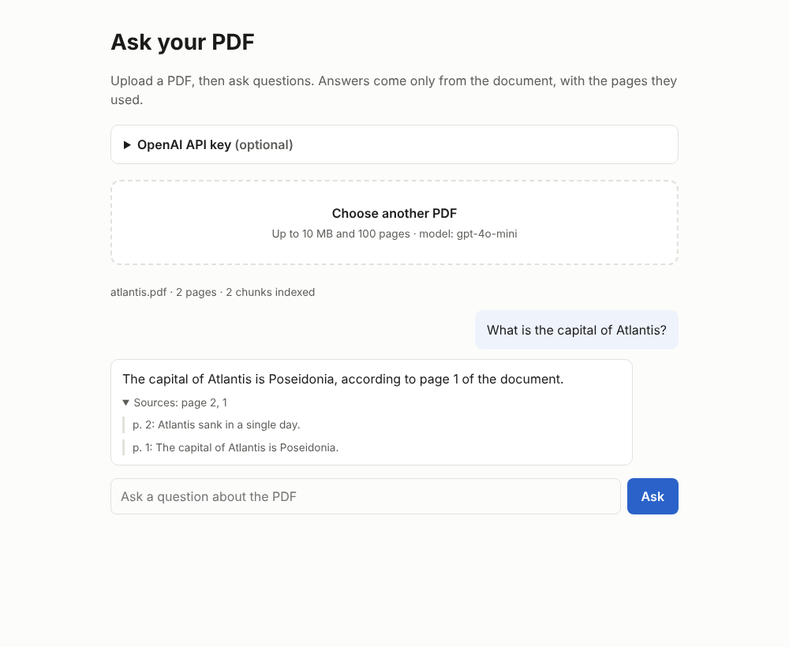

# rag-pdf-chatbot

[](https://github.com/Mahnoori15/rag-pdf-chatbot/actions/workflows/ci.yml)

A retrieval-augmented generation (RAG) chatbot that answers questions about a PDF.
It runs as a web app (FastAPI) or from the command line, and ships with Docker, tests and CI.
It can also deploy automatically to Hugging Face Spaces.



## How it works

1. **Load**: the PDF is read page by page with `PyPDFLoader`.
2. **Chunk**: pages are split into ~1,000-character chunks with a 200-character overlap.
3. **Embed & index**: chunks are embedded with OpenAI embeddings and stored in a FAISS vector index.
4. **Retrieve & answer**: for each question, the 3 most relevant chunks go to an OpenAI chat model,
   which answers from that context. The web app shows which pages each answer came from.

## Run the web app

```bash
python -m venv .venv
source .venv/bin/activate        # Windows: .venv\Scripts\activate
pip install -r requirements.txt
cp .env.example .env             # add your OpenAI API key (optional; see below)
uvicorn api:app --reload --port 7860
```

Open http://localhost:7860, upload a PDF and ask questions.

### With Docker

```bash
docker build -t rag-pdf-chatbot .
docker run -p 7860:7860 --env-file .env rag-pdf-chatbot
```

## Command-line version

```bash
python app.py path/to/document.pdf
```

## API

| Method | Path | Purpose |
| --- | --- | --- |
| `GET` | `/health` | Health check |
| `GET` | `/api/config` | Limits, model and whether a server key is set |
| `POST` | `/api/upload` | Upload a PDF (multipart `file`); returns a `session_id` |
| `POST` | `/api/ask` | `{"session_id", "question"}` → `{"answer", "sources", "questions_left"}` |

Interactive API docs are at `/docs` while the app is running.

## API keys and cost

- If the server has `OPENAI_API_KEY` set, visitors can use the app without a key.
- Visitors can also paste **their own key** in the page. It is sent with their requests, used for
  that PDF only and never stored.
- **On a public deployment, leaving a server key set lets anyone spend your OpenAI credit.**
  Either leave it unset (so visitors bring their own key) or set a monthly spending limit in your
  OpenAI account. The limits below cap usage per PDF.

## Configuration

| Variable | Default | Meaning |
| --- | --- | --- |
| `OPENAI_API_KEY` | – | Server key (optional) |
| `OPENAI_MODEL` | `gpt-4o-mini` | Chat model |
| `MAX_PDF_MB` | `10` | Largest upload |
| `MAX_PAGES` | `100` | Most pages per PDF |
| `MAX_QUESTIONS` | `30` | Questions per uploaded PDF |
| `MAX_SESSIONS` | `20` | PDFs held in memory at once (oldest are dropped) |
| `SESSION_TTL_MIN` | `60` | Minutes before an idle PDF is dropped |

## Deploy to Hugging Face Spaces

1. On [huggingface.co](https://huggingface.co/new-space), create a new **Space** with the **Docker** SDK
   (blank template).
2. In the Space's **Settings → Variables and secrets**, optionally add `OPENAI_API_KEY` as a secret
   (read *API keys and cost* first).
3. Create a Hugging Face access token with **write** permission.
4. In this GitHub repo, go to **Settings → Secrets and variables → Actions** and add:
   - secret `HF_TOKEN`: the token from step 3
   - variable `HF_SPACE`: your Space id, e.g. `your-hf-username/rag-pdf-chatbot`
5. Push to `main` (or run the *deploy to Hugging Face Spaces* workflow by hand).
   Once CI passes, the app deploys to the Space automatically.

## Tests

```bash
pip install -r requirements-dev.txt
python -m pytest tests
```

The tests use fake embeddings and a fake chat model, so they need no API key and cost nothing.
GitHub Actions runs them on every push and pull request, then builds the Docker image and checks
that the container starts.

## Project structure

| Path | Purpose |
| --- | --- |
| `api.py` | FastAPI web app and JSON API |
| `static/` | Web interface (HTML, CSS, vanilla JS) |
| `rag_pipeline.py` | `RAGPipeline`: loading, chunking, indexing and querying |
| `app.py` | Command-line interface |
| `tests/` | Pipeline and API tests |
| `Dockerfile` | Container image (port 7860) |
| `.github/workflows/` | CI and Hugging Face deployment |

## Using the pipeline in your own code

```python
from rag_pipeline import RAGPipeline

pipeline = RAGPipeline()
pipeline.initialize_from_pdf("report.pdf")
result = pipeline.query_with_sources("What are the key findings?")
print(result["answer"])
for source in result["sources"]:
    print(f"page {source['page']}: {source['text'][:80]}...")
```
